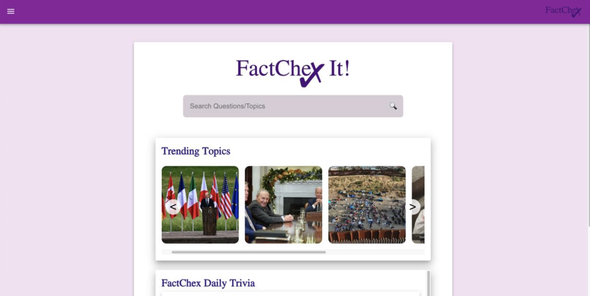
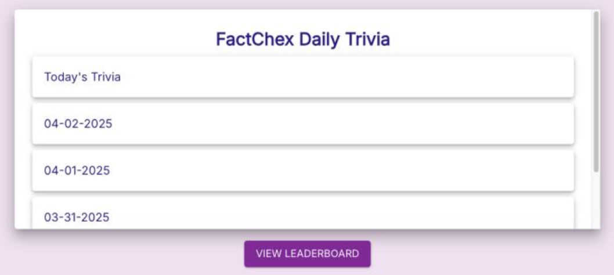
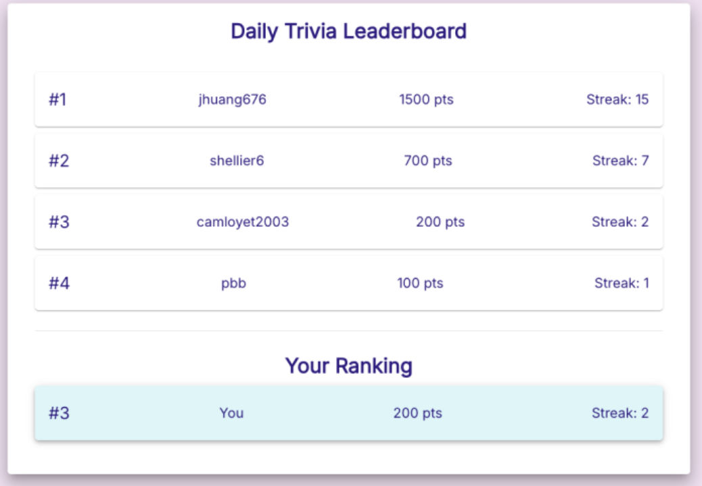

# FactChex - AI-Powered Media Bias Analyzer

## Project Summary

FactChex is a full-stack web application developed by a five-person team during a two-semester, client-sponsored capstone at Georgia Tech (August 2024–May 2025). The project helps users explore news articles and political claims through AI-assisted responses, source references, and media-bias analysis. The website also includes user accounts, saved chat history, trending topics, and daily trivia.

My primary contributions were the Firebase data model, authentication flows, database operations, and integration between the React interface and Firebase. I also supported the team's Git workflow, resolved integration conflicts, and prepared the installation guide for the client.

> **Note: This is a portfolio entry.**
>
> This was a client-sponsored project. At the conclusion of the capstone, all code and intellectual property were transferred to the client. This repository serves as a detailed breakdown of the project's architecture and my specific contributions.

## Key Features

### 1. AI Analysis Chatbot
Users can submit a URL to a news article. The AI backend (using the OpenAI API and Serpapi) analyzes the content for trustworthiness, bias, and reliability, returning a summary and a score from 1-10.

### 2. Claim Verification
In a familiar chatbot format, users can also ask a question or submit a claim (e.g., "Is X claim true?") to receive a real-time, AI-generated, and sourced answer.

### 3. User Authentication & History
Users can create an account, log in, and view their entire chat history. This system, which I built, also supported secure admin-level roles.

### 4. Daily Trivia & News
To engage users, we also implemented a daily multiple-choice trivia question and a feed of current news articles.

## Tech Stack

* **Frontend:** React.js, HTML, CSS
* **Backend:** Flask / Node.js
* **Database & Auth:** Firebase (Firestore, Firebase Authentication)
* **AI & APIs:** OpenAI API, Serpapi (for real-time search results)
* **Version Control:** Git & GitHub

## My Role & Contributions

As a core full-stack developer on the team, I focused on database architecture, user authentication, and technical leadership.

### 1. Firebase Architect (My Primary Role)
I owned approximately **90% of our Firebase implementation** from the ground up. This included:

* **Database Design:** Architecting the NoSQL (Firestore) database schema to store all user data, chat history, and trivia content.
* **Authentication:** Implementing the complete user auth flow (sign-up, sign-in, sign-out) using Firebase Authentication.
* **Backend Logic:** Writing the core backend functions for all database interactions (CRUD operations), such as saving a user's chat message, retrieving their chat history, and managing admin-level data.
* **Admin Controls:** Building the logic and security rules for admin-level accounts.

### 2. Full-Stack Integration
I was responsible for the **data integration** between our React frontend and Firebase. While the team collaborated on building the React UI pages, I personally wrote the **data-handling logic** (e.g., from sign-up, login, and chat forms) to securely connect to, send, and fetch data from the Firebase backend.

### 3. Git & Team Leadership
I served as the team's main point of contact for Git and GitHub. I helped all team members with version control problems, established our branching strategy, and was responsible for **resolving all major merge conflicts**, ensuring a smooth development workflow. I also created the final installation guide for the client.

## Screenshots

The screenshots below document the FactChex website and an earlier chatbot interface. They illustrate the team's product; my individual contributions are described above.

### Home Page

The home page brings together the question-entry interface, trending topics, and daily trivia, giving users several ways to explore the site's content.

### Trending Topics

The topic view presents a summary, analysis, and source references for a selected news topic. These examples illustrate the interface and should not be treated as independently verified reporting.

### Daily Trivia

The trivia section provides access to the current question and previous daily entries. It complements the fact-checking features with a recurring activity.

### Leaderboard

The leaderboard displays example scores, streaks, and a highlighted ranking for the current user. The entries shown are demonstration data, not evidence of public adoption.

### Earlier Chatbot Interface

This screenshot preserves an earlier version of the question-and-response interface. It illustrates the interaction flow rather than the final website layout or the accuracy of generated answers.

